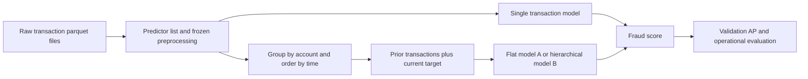

# TF: my project guide

> Public first-person adaptation of documents originally prepared by CH on 2026-10-05. I retain the findings and their original review scope; CH performed the reported independent checks. Source paths are illustrative references to my private project, with `my_work/` representing my work and Ya identifying my collaborator. Source code, private evidence files and bank data are not included in this document set. Later changes require a separate review.

I use this guide to explain the private TF project as reviewed by CH on 2026-10-05 UTC. It describes the recovered source snapshot, not a live bank deployment.

## What Ya and I are trying to do

We are trying to predict whether a debit-card transaction is fraudulent using the information available when that transaction arrives. The target is `frd_tag`. A successful model ranks fraud above legitimate transactions while keeping the number of alerts manageable.

In this public guide, I call my contribution directory `my_work/` and use `My` and `Ya’s` as ownership labels for artifact areas. These are public aliases, not the original source paths or account identifiers. Attribution follows my project context and the written plans; it is not independent proof of who authored every line.

The research question progresses from “can a transformer score one transaction?” to “does the account's recent behavior help?” and then “can pretraining improve the representation?” The internal XGBoost debit-card model is the practical baseline to beat. There is no checked-in, matched fraud evaluation proving this transformer beats it.

The early comparison in `docs/tabular_transformer_models.md` uses the **UCI Bank Marketing** dataset, whose target is deposit subscription. It is not a fraud benchmark. Models there also use different splits and training settings. It supports investigating FT-Transformer, not a production-superiority claim.

## What FT-Transformer means

FT means **Feature Tokenizer**. Instead of reading words, the model reads table fields such as amount, available balance, transaction type, and hour of day.

1. Frozen preprocessing fills missing numbers, standardizes numeric values, and maps categories to integer IDs.
2. The tokenizer turns each field into a short learned numeric vector, called a token. Each numeric field has its own parameters; categorical fields have embedding tables.
3. Attention lets these field representations interact. For example, an amount can mean something different given the account balance and transaction type.
4. A learned summary token, `[CLS]`, collects information used by a classifier to produce fraud/nonfraud logits. Softmax converts these to scores.

This is a structured-data neural network, not a language model reading transaction descriptions. Attention weights should not be presented as causal explanations of fraud.

The original baseline uses the vendored PyTorch Tabular FT-Transformer. The history and Phase 5 models use custom PyTorch transformer blocks. They follow the feature-tokenization idea, but use different blocks, normalization, and activations. The repository is an applied extension, not a demonstrated exact reproduction of a research paper's experiments.

## The data path



The default predictor list has six raw numeric fields, thirteen raw categorical fields, and four derived date/time categories. Six numeric-missingness indicators are added as categories. History models also add elapsed time to the target as a numeric field. This gives **30 feature tokens per transaction** in the default sequential setup.

The intended split uses early-numbered training files, separate validation files around 4950, and evaluation files around 8000. Preprocessing is fit on training files and reused. Those are sensible conventions, but filenames and separate S3 locations do not prove chronological separation, unique transaction IDs, or absence of overlap. The actual data must establish those facts.

Sequence construction assumes each account's transactions are contained in one parquet file. It does not carry account history across files. This is explicitly documented; verify the assumption on the bank data before relying on complete histories.

## What Ya built

The later detailed plans use this numbering; the README and older overall plan are stale.

| Phase | Purpose | Main implementation | Evidence available here |
|---|---|---|---|
| 1 | Choose features and freeze preprocessing | `fraud/data/`, artifact builder, predictors/configs | Code, tests, documented artifact contract; no bank artifacts |
| 2 | Prove a small single-transaction baseline works | `fraud/scripts/train_baseline.py`, `score_eval.py` | Code and documented smoke results |
| 3 | Train on data too large for one DataFrame | `ParquetStreamingDataset`, `fraud/streaming_model.py`, streaming scripts | Code and documented runs; recovered integration currently broken |
| 4 | Add per-account transaction history | `SequenceBuilder`, `fraud/sequential_model.py`, sequential scripts | Code, sequence tests/notebook, documented history-5 results |

So the repository supports my recollection that Ya had implemented and reported work through Phase 4. It does not prove that every acceptance criterion was completed. His design explicitly deferred the hierarchical alternative; I implemented that alternative in Phase 4b.

## My Phase 4a: Architecture A, flat history

For every target transaction, my pipeline builds a window of the account’s previous N transactions plus the target. The target's label is the training answer; previous fraud labels are not input features.

All field tokens from all transactions enter one transformer:

```text
[CLS] + [oldest transaction's fields] + ... + [current transaction's fields]
                              ↓
                         fraud score
```

`history_len=5` means **five prior transactions plus the current one: six total**. `history_len=16` means seventeen total. These are counts, not days. Short histories are padded on the left and padding is masked from attention. Position embeddings express order; time deltas express actual recency.

With the default feature set, token lengths are 181 for h5, 331 for h10, and 511 for h16. Attention work grows roughly with the square of token length, explaining the longer-history memory pressure.

My smaller physical batches plus gradient accumulation keep the nominal effective batch at 4096: 1024×4 for h10 and 256×16 for h16. This is a reasonable memory workaround. It is not a guarantee that training trajectories are identical: dropout, short batches, data ordering, and optional EMA can still differ.

The code does not actually insert the SEP separator tokens described by some comments. Feature tokenization and transaction position still identify the structure; the documentation should describe the actual implementation.

## My Phase 4b: Architecture B, hierarchical history

This means two levels of processing:

```text
Each transaction's fields → transaction encoder → one transaction summary

[oldest summary] ... [current summary] → history encoder → fraud score
```

The first level studies relationships between fields within one transaction. The second studies relationships between transactions. The second level handles only T transaction summaries plus its summary token, rather than T×30 field tokens.

This is a sensible way to make longer histories affordable. It still pays for the first-level encoders and may discard useful detail when compressing a transaction. Therefore “cheaper history attention” is supported; “better accuracy” requires measured results.

Architecture B has separate transaction and sequence encoder depths, so A-versus-B is a comparison of complete configured systems, not a pure one-variable test of attention layout. Report parameter count, throughput, memory, and accuracy together.

## My Phase 5: pretraining

Pretraining tries to learn useful representations before final fraud classification.

- **Masked autoencoder / SSL:** hide some input fields and train the encoder/decoder to reconstruct them. Labels are not used in the reconstruction loss.
- **Supervised contrastive learning / SupCon:** make two corrupted versions of each transaction and encourage representations with the same class label to be close. This method does use fraud labels, despite living under the broad pretraining umbrella.
- **Fine-tuning:** transfer encoder weights to a fraud classifier, then train the classifier and optionally the encoder.
- **Linear probe:** freeze the encoder and train only the final classification layer, to assess the representation.

Valid SSL and SupCon encoder checkpoints transfer into the supplied single-transaction fine-tuner correctly in synthetic checks. However, the supplied Phase 5 path is **single-transaction classification**. It is not currently wired to initialize the winning history model A or B. That integration remains work to do if Phase 5 is intended to improve the sequential winner.

Two pretraining-objective defects were reproduced; see [my audit findings](AUDIT_FINDINGS.md). Successful backward passes alone do not make those objectives correct.

## My ablations and what they answer

An ablation is a controlled experiment changing a model ingredient. My h5 finder has 2 embeddings × 2 attention settings × 2 optimizers = 8 configurations. Then the long-history sweep fixes the winning recipe and tries h10/h16. The hierarchical sweep tries h5/h10/h16 with the selected recipe.

The checked-in ablation runners and YAMLs are present. The generated `ablations/` directory, result CSVs, checkpoints, prediction parquet files, and bank pod logs are absent from this checkout. The current-standing Markdown is a record of reported results, not independently replayable evidence of those runs.

## What the current-standing snapshot says

Snapshot: **2026-10-04 23:09, pod log time**. This is not a live job-status check.

| Experiment | Training files | Prior history | Reported best validation AP | Reported evaluation AP / status |
|---|---:|---:|---:|---|
| Flat h5, selected recipe | 10 | 5 | 0.136500 | 0.0893 |
| Flat h10, selected recipe | 10 | 10 | 0.139942 | 0.0902 |
| Flat h16, selected recipe | 10 | 16 | 0.138256 | 0.1171 |
| Flat h5 confirmation | 100 | 5 | 0.141585 | Training complete; scoring pending |
| Hierarchical sweep | 10 planned | 5 / 10 / 16 | None recorded | First run had just started |
| Ya single-transaction reference | 100 | 0 | 0.124700 | 0.0940 reported |

The h5@100 run stopped after epoch 6; its best was epoch 1 and patience was five, consistent with early stopping. “100” here is the number of training files, not a history length or evaluation-file count.

The nominal validation difference between my h5@100 and the documented single-transaction reference is 0.016885 AP, about 13.5% relative. That is encouraging reported evidence, not a certified improvement: training coverage, validation membership, artifact versions, and run provenance must match first.

Do not select h16 just because its already-viewed evaluation AP is higher. The tiny h10-versus-h16 validation gap is inconclusive from these single-seed observations. Neither statistical equivalence nor significance was established.

## How to read the metrics

- **AP / average precision:** summarizes the precision–recall ranking curve. At fraud prevalence around 0.15%, random ranking has AP around 0.0015. AP around 0.14 is promising ranking performance. It does **not** mean 14% accuracy or 14% of fraud caught.
- **AUROC:** summarizes ranking separation across false-positive rates. A high value can coexist with poor precision at the bank's actual alert budget, so AP and operational metrics matter.
- **Precision at an alert budget:** of the transactions flagged for review, how many are fraud?
- **Recall at an alert budget:** of all fraudulent transactions, how many are caught?
- **Calibration:** whether a score such as 0.10 corresponds to approximately 10% observed fraud among similarly scored transactions. This matters for probability thresholds and expected-loss decisions.

My use of full-validation AP for checkpoint selection is appropriate. Averaging tiny-batch AP would be misleading at this fraud rate; the callback correctly pools scores before computing AP on one process.

Strictly increasing recalibration preserves rankings and therefore AP/AUROC. I do not need to calibrate just to compare AP on the same unchanged cohort. Isotonic calibration can create ties and change ranking metrics; calibration is mainly needed for probability interpretation. Evaluate both discrimination and calibration on separate, appropriate data.

## What my work establishes, and what I still need

The work broadly follows Ya’s intended extension: shared frozen preprocessing, no prior-label inputs, per-account history, configurable recency/order, padding masks, validation-based selection, and a scalable hierarchical alternative. The synthetic checks also confirm padding invariance and metadata/label/amount alignment in the tested cases.

Before another broad sweep, I need reliable data coverage, reproducible runs and exact manifests. The Phase 5 objectives need correction before affected pretraining experiments. I then need to compare matched h0/h5/h10/h16 controls using several seeds and an untouched later-in-time test. An h0 run of the same custom model is especially useful: it separates the effect of history from changes to the model implementation and training recipe.

I need account-aware or time-block uncertainty estimates because windows overlap within accounts. I also need bank-side checks of timestamp order, label availability, ID uniqueness and split overlap. My comparison with the bank’s existing model must use exactly the same transaction IDs and operational alert budgets. Additional architecture complexity should follow reliable evidence from these comparisons.
